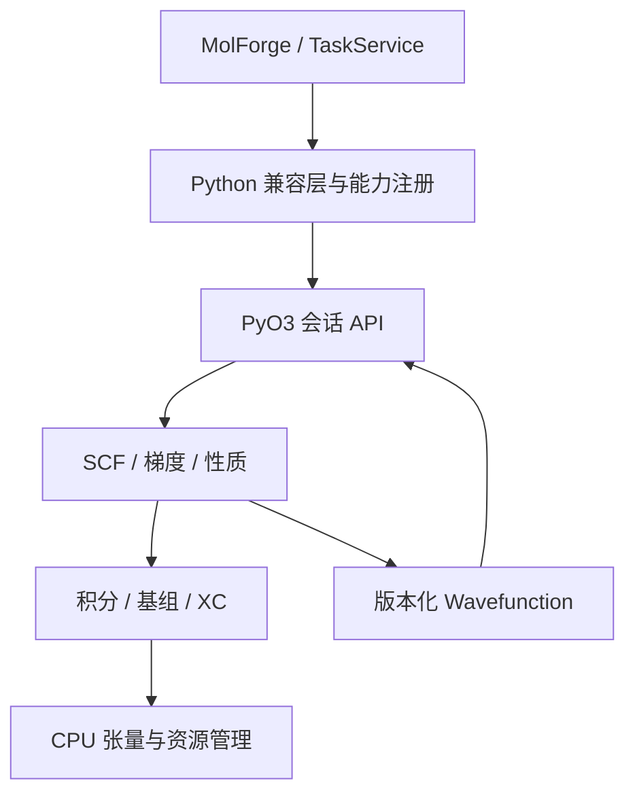

# CalChem 可执行重构方案

2026-10-29 · 基于附件中的 v0.6.0 源码、v1.0 骨架、项目总结和研究提示词

## 先说结论

当前规划不能保证 CalChem 在速度、稳定性、精度和方法覆盖面上同时超越 Gaussian、ORCA、PySCF 和 REST。它是目标清单，不是已经验证的实现。尤其是 v1.0 的 SCF 返回写死的 H₂/H₂O 能量和固定收敛状态；积分、梯度、轨道网格返回零；不认识的基组会生成假壳层。必须禁止这类结果流入 MolForge。

建议采用 **Python 现有服务与前端 + Rust 数值核心 + 经过验证的 C 积分/XC 库**。v0.6.0 作为保留的参考实现和跨后端回归工具，按垂直切片逐个替换最慢的算子。不用语言本身推断速度。REST 已经使用 Rust、Rayon 和无磁盘 RI；仅重复这套栈不能构成领先优势。[R1]

“超越”应定义为若干明确场景下的可重复优势：同几何、基组、电子态、冻结核、积分近似、DFT 网格、收敛容差和硬件预算；同时报告总耗时、峰值内存、失败率和科学误差。不同方法或不同近似的能量不能直接解释成“精度更高”。

## 本次能核实的项目状态

| 材料 | 能确认的事实 | 目前不能确认的事 |
|---|---|---|
| `CalChem_Rebuild_Research_Core.zip` | 包含 Python 积分、RHF/UHF、DFT、RI、后 HF、基组数据、`CalculationRequest`/`Result` 和 `TaskService` 的代码。`backends/native.py` 对接原生计算。 | 压缩包缺少 `calchem_current/mol/` 及声称的 22 个测试；本环境不能复现“已通过”或数值性能。`grad/analytical.py` 虽存在，但不能作为已完成解析梯度。 |
| `CalChem_v1.0_NextGen_Architecture_and_Code.zip` | 有八个 Rust crate、PyO3 入口和架构白皮书。 | 没有可用的真实 SCF 闭环、完整基组、真实梯度、Cube 或原版兼容适配层；也无测试。 |
| `PROJECT_COMPLETE_SUMMARY.md` / `REBUILD_RESEARCH_PROMPT.md` | 清晰描述 Windows 11、8 核/15.1 GB、MolForge、单任务重计算、C 盘限制及数值目标。 | 三后端数值、既有打包和 22 个测试属于项目记录，不等于本次独立复验。 |

局部位置：v1.0 `crates/calchem-scf/src/solver.rs:27-45`、`crates/calchem-int/src/direct_jk.rs:5-13`、`crates/calchem-grad/src/hf_grad.rs:4-10`、`crates/calchem-basis/src/bse_loader.rs:42-51`；v0.6.0 `calchem_current/scf/hf.py`、`calchem_current/integrals/`、`calchem_current/core/request.py`、`calchem_current/backends/native.py`。

旧版 `grad/analytical.py:29-47` 读取 `mf._hcore`，实际 `scf/hf.py` 保存为 `mf._h_core`；梯度组装也没有 Pulay 重叠导数项。这些是源码层面的阻断问题。旧版 `grad/hf_grad.py` 默认仍采用数值梯度，DFT 梯度也采用差分。因此原项目应作为核对思路和既有 API 的材料，关键科学方法须重新验算。

## 战略选型

| 方案 | 数值/HPC 生态 | Windows 与 MolForge | 决策 |
|---|---|---|---|
| Rust + C 库 + Python | Rust 管资源和并行，调用成熟 libcint、Libxc、BLAS；需要维护 FFI 和跨库数据布局。 | PyO3/maturin 可产 Windows 扩展；现有 Python 契约可继续使用。[R2][R3][R4] | **推荐。** 保持薄 FFI，先使用单一 CPU 后端。 |
| C++20 + Python | BLAS、积分及 GPU 生态成熟；原生 ABI、工具链和内存所有权需严控。Psi4 是成熟参照。[R5] | 可行，但项目目前已有 Rust 骨架。 | 若实际 libcint/Libxc/BLAS 的 Rust FFI 成为长期阻碍，再做针对性技术比较。 |
| Julia + Python | 研究原型效率高；本项目现有桌面发布链要另建。 | 需验证 Windows one-folder 与 PyQt/VTK 混合发布。 | 用作算法试验，不作为首个交付核心。 |
| Mojo | 需要先证明依赖、部署、接口与长期维护需求。 | 暂不满足现有稳定发布目标的证据要求。 | 暂不进入关键路径。 |

`libcint` 官方支持笛卡尔/实球谐、1e/2e/3c 积分及导数，且线程安全；这是首版积分内核的合理起点。[R2] Libxc 负责交换关联**局部/半局部部分的数值求值**，混合泛函的精确交换、网格、色散以及某些非局域项仍须由 CalChem 自己组装并验证。[R3] 基组从 BSE 固定版本导入，保存来源和校验值，基组缺失即报错。[R6]

## 架构与数据所有权



依赖方向应是 `basis` 和 `tensor` → `integrals` → `scf` → `grad`/`prop` → `opt`/`response`/`corr`，Python 绑定只在最外层。旧蓝图把基组画在积分层之上，会与积分对壳层元数据的依赖冲突。GPU 是未来可替换的执行后端，不应先把全部算法压进一套宽泛 `TensorBackend` trait。跨 CPU/GPU 边界需明确数据搬运与同步成本。

```rust
// 文件：crates/calchem-model/src/lib.rs（计划新增，共享值类型）
pub struct Molecule { pub atoms: Vec<Atom>, pub charge: i32, pub multiplicity: u32 }
pub struct Atom { pub z: u8, pub position_bohr: [f64; 3] }
pub struct MethodSpec { pub reference: Reference, pub basis_id: String, pub options: MethodOptions }
pub enum Reference { Rhf, Uhf, Rks { functional: String }, Uks { functional: String } }
pub enum CalcError { InvalidInput(String), Unsupported(String), Numerical(String), NotConverged(ScfDiagnostics), ResourceLimit(String) }

// 文件：crates/calchem-basis/src/lib.rs
pub trait BasisProvider { fn load(&self, id: &str, atoms: &[Atom]) -> Result<BasisSet, CalcError>; }
pub struct BasisSet { /* 壳层、归一化、AO 顺序、球谐约定、ECP、来源版本 */ }

// 文件：crates/calchem-int/src/lib.rs
pub trait IntegralEngine: Send + Sync {
    fn one_electron(&self, mol: &Molecule, basis: &BasisSet, op: OneElectronOp) -> Result<SymMatrix, CalcError>;
    fn eri_shell_block(&self, basis: &BasisSet, ijkl: [usize; 4], out: &mut [f64]) -> Result<(), CalcError>;
    fn jk(&self, basis: &BasisSet, density: &SymMatrix, opts: &JkOptions) -> Result<JkMatrices, CalcError>;
}

// 文件：crates/calchem-scf/src/lib.rs
pub fn solve_scf(input: &ScfInput, ints: &dyn IntegralEngine) -> Result<ScfResult, CalcError>;
pub struct ScfResult { pub energy_eh: f64, pub wavefunction: Wavefunction, pub diagnostics: ScfDiagnostics }
pub struct Wavefunction { /* molecule, basis, AO 顺序, C_alpha/beta, eps, occ, D, provenance */ }

// 文件：crates/calchem-grad/src/lib.rs
pub trait GradientEngine {
    fn gradient(&self, input: &ScfInput, result: &ScfResult) -> Result<Vec<[f64; 3]>, CalcError>;
}

// 文件：crates/calchem-prop/src/lib.rs
pub fn orbital_grid(wfn: &Wavefunction, orbital: OrbitalId, grid: GridSpec)
    -> Result<OwnedGridF32, CalcError>;
```

签名是实现契约草案，不代表代码已经存在。`Wavefunction` 必须包含轨道系数与基组，并持有结果数组所有权；否则 `orbital_grid` 无法计算。NumPy → VTK 的浅拷贝只能在明确数组持有者和 VTK 生命周期时启用，先用深拷贝端到端验算，再以测量决定是否优化。

### 每层算法与验证重点

| 层 | 首选算法/结构 | 验收要点 |
|---|---|---|
| 模型/基组 | Bohr 内部单位；固定 BSE 数据快照；壳层与 AO 映射；ECP 与全电子显式区分 | 电子数/多重度奇偶、归一化、AO 排序、球谐相位、未知元素拒绝 |
| 积分 | libcint 1e/4c 壳层块；小体系可全 ERI；后续 Schwarz/密度筛选、DF-J | 置换对称、导数差分、筛选误差上界、近线性相关输入 |
| 张量/资源 | packed 对称矩阵用于存储，矩阵分解按库所需转 dense；有界分配与溢出检查 | (S) 正定性、特征向量残差、峰值内存、并发配额 |
| SCF | Löwdin/规范正交化，RHF 首行；后加 DIIS [R12]、UHF；明确能量与残差双判据 | 多几何能量、Tr(DS)=N、FDS−SDF、未收敛返回诊断 |
| DFT | 固定网格/权重 + Libxc LDA/PBE，之后混合泛函交换与网格响应 | 网格收敛、积分精度、相同定义的函数泛函、梯度差分 |
| 梯度/优化 | RHF 核排斥 + 1e/2e 导数 + Pulay 项 [R12]；几何优化待梯度通过后接入 | 平移/旋转不变性、每坐标五点差分、优化终点的梯度 |
| 相关/响应 | RI-MP2、CIS/TDA 按独立模块逐个加入 | 冻结核及辅助基组一致，激发态顺序、跃迁强度与误差 |
| 溶剂 | C-PCM 后引入 SMD 参数 | 腔体、能量、力在移动原子时连续；模型参数追溯 |
| GPU/分布式 | 先做 profile，再选择计算占比高的核；跨进程消息/检查点独立于线程池 | 数据搬运计入总时间，回退路径，数值等价与可恢复性 |

## 竞争对标与可赢的方向

Gaussian、ORCA、Q-Chem 已拥有广泛的方法和经长期优化的积分/SCF 实现；ORCA 的 RIJCOSX 与 DLPNO、Q-Chem 的 GPU 支持都是现成能力。[R7][R8] PySCF 的 C 积分核和 GPU4PySCF，以及 Psi4 的 Python/C++、密度拟合架构说明“Python 前端”并不必然意味着慢。[R5][R9] NWChem 提供成熟的模块与分布式计算参照；REST 直接使用 Rust、RI、Rayon。[R1][R10]

建议把近期差异化放在：**可信的多后端统一数据契约 + 可复现的数值记录 + MolForge 的快速交互 + Windows 单目录易用性**。数值内核的速度在某些明确任务上争取领先，不能现在承诺所有方法、所有规模都领先。方法精度由物理近似、基组与收敛决定，同一个 RHF/基组/几何的正确答案应彼此一致。

## 优化项：先量后做

| 技术 | 何时考虑 | 必须测量或控制的代价 |
|---|---|---|
| Direct JK + Schwarz | RHF 正确性闭环后 | shell quartet 数、筛选上界、线程合并开销；不可把全密度最大值当成所有块的安全局部界 |
| RI-J / RI-JK | 辅助基组、3c/2c 积分、度量分解可验证后 | 对同体系比较 RI 与 exact J/K 误差；packed 非对角密度有 2 倍权重 |
| Cholesky/张量分解 | 大基组中 4c 积分占主导时 | 分解阈值、重建误差、内存，不能先写固定倍数加速 |
| Rayon/BLAS 并行 | profile 确认瓶颈后 | 避免 Rayon × BLAS 过度订阅；1/2/4/8 核强扩展测量 |
| SIMD/AVX-512 | libcint 与 BLAS 标杆后 | Zen 5 上实测吞吐；提供可移植基线构建与 CPU 特性检测 |
| 混合精度 | 有误差传播与纠错策略后 | 最终总能/力误差；不可默认早期 FP32 总是安全 |
| AD/ML | 明确局部可微模块和训练外推范围后 | AD 不能自动生成积分、Pulay/网格响应；ML 只作有验证的初猜或筛选 |
| GPU/线性标度 | 有可代表的较大体系和显存后 | 传输、核启动、预处理、误差与失败案例；当前无 GPU，不写收益承诺 |

以双精度三中心张量为例，`nbf=500, naux=1500`，packed 后是 `1500×500×501/2×8 = 1.503 GB`（十进制），尚未计入导数、AO/MO 转换、BLAS 临时数组及 Python/VTK。15.1 GB 机器上“全程零磁盘”并非通用保证。内存配额应与实际分配的所有权绑定，失败即释放，原子预留要用 CAS 或锁保证并发上限。

## 阶段和退出门槛

| 阶段 | 成果 | 可执行门槛 | 工作量（估计，非承诺） |
|---|---|---|---|
| 0：恢复可运行基线 | 补齐 v0.6.0 `mol/`、原测试、依赖与许可信息；收集 Windows 环境和基准结果；v1.0 占位接口改成明确错误 | `python -m pytest tests/unit -q`；任何未实现方法/基组返回失败；记录环境哈希 | 1–3 周/人 |
| 1：RHF 核心 | H/He/O 的 STO-3G 加载、1e/4c、正交化、Fock、SCF、波函数；能量随 H₂ 键长变化 | `cargo test --workspace`；H₂(1.4 Bohr)、He、H₂O(Szabo) 能量与独立参考在同约定容差内；`Tr(DS)`/残差/非收敛测试 | 4–10 周/人 |
| 2：可用 CPU 平台 | UHF、更多 BSE 基组、Direct JK、筛选、DIIS、DF-J、RHF 梯度、优化、真实 orbital grid | exact/DF 对照、梯度与五点差分、完整 GUI 任务、1/2/4/8 核报告 | 3–6 个月/小团队 |
| 3：OSC 工作流 | RKS/UKS、固定网格、PBE/B3LYP、TDA-TDDFT、C-PCM、频率、RI-MP2 | 多网格/基组收敛、激发态与溶剂参数对照、解析/差分梯度 | 6–12 个月/小团队 |
| 4：拓展 | CCSD(T)、SMD、局域相关、GPU 或分布式，依阶段 3 profile 决定优先级 | 独立方法基准，误差与速度 Pareto 曲线，发布复现包 | 多年持续研发 |

“小团队”与工期只是工程规模估计；不能凭这些估计承诺追平成熟软件的全部功能。阶段 1 的数值参考要附原始输入/输出、坐标单位、核电荷、参考态、积分/SCF 容差，并独立计算，不将旧 `solver.rs` 写死的数值作为实现证明。

验收命令建议统一成 `python -m pytest tests/unit tests/contracts tests/numerics -q`、`cargo test --workspace --release`、`python -m calchem_bench run --manifest benches/manifest.json --output benchmarks/results/local.json`、`python -m calchem_bench compare benchmarks/results/local.json --reference benchmarks/references/`。后两个命令代表**需要实现的新基准工具**，当前附件没有它们。阶段 0 预期所有未实现请求显式失败；阶段 1 预期 RHF 测试通过且不同键长能量变化、误差在记录的容差内；阶段 2 预期梯度/DF/多核检查通过；阶段 3 预期 DFT 网格与激发态/溶剂误差检查通过。任何一项失败都禁止宣称达到该阶段。

## 第一阶段逐文件任务清单

1. `crates/calchem-model/src/lib.rs`：`Molecule::try_new(...) -> Result<Self, CalcError>`；检查长度、有限坐标、电子数/多重度、原子重叠；`CalcError` 类型与代码；不能用全局状态传播失败。
2. `crates/calchem-basis/src/bse_loader.rs`、`data/sto-3g.json`：`BasisProvider::load`；只接受有数据的元素；保留指数、系数、收缩、归一化、AO 映射和数据校验值。
3. `crates/calchem-int/src/cint_bridge.rs`：单独封装 `atm/bas/env` 以及布局/生命周期；实现 S/T/V 和 4c 壳层块；以对称性和旧 Python 核交叉验证。
4. `crates/calchem-tensor/src/cpu_faer.rs`：返回特征值**与特征向量**，检查残差 `||SC−Cλ||`；重叠矩阵小本征值处理策略纳入诊断。
5. `crates/calchem-scf/src/solver.rs`、`diis.rs`：真实 RHF 迭代、密度/残差/能量日志，最大迭代失败；先禁用 RI/DFT/其他方法的假成功路径。
6. `crates/calchem-py/src/lib.rs`、`calchem/_core.pyi`：`run_single_point` 返回 `ScfResult` 或显式 Python 错误；核算出错不隐藏；`allow_threads` 仅包装没有 Python 引用访问的计算。
7. `calchem/backends/native.py`：按请求的能力映射调用 Rust 或现有 Python 实现；`Result.actual_method`、`status`、`errors` 准确标记执行引擎，不以有限非零能量推断收敛。
8. `tests/numerics/test_rhf.py`、`tests/contracts/test_routing.py`、`benches/manifest.json`：多几何 H₂、He、水、负例与对照输入；保存原始输出，不只对比单个总能量。

这份附件的 v1.0 中尚无原版 `native.py` 和原测试，必须先补齐原项目文件，不能凭文档中的路径假定可直接原地迁移。

## 性能/稳定性/精度共同验收表

测试集合至少包含小体系（H₂、He、H₂O）、开壳层（OH）、中体系（甲醛、苯、咖啡因）、OSC 相关中大体系及困难 SCF 例子。每个样本固定坐标、荷电/自旋、球谐约定、基组与辅助基组版本、ECP、方法和泛函定义、网格、收敛阈值、线程和 BLAS 设置。

- **精度**：先验证恒等式及解析/差分梯度；再对照同方法的独立实现；声称“更准确”必须对高等级参考或实验数据说明误差定义及不确定性。
- **速度**：Windows 11/9700X/15.1 GB 同机、同参数，进程启动和计算时间分别记录；5 次预热后重复至少 7 次，报中位数与离散度、峰值工作集、每阶段耗时。小体系也报初始化开销，不能只报内核函数。
- **稳定性**：固定困难体系和扰动几何、100 次以上重复/批量计算，报告收敛率、错误类型、残差、最大资源使用；失败时绝不标为成功。
- **可移植性**：Windows one-folder 离线全新用户账户启动；CPU 通用版与 Zen 5 优化版分别构建和验证；Linux 运行及数值差异单独记录。

保留一个 `benchmarks/results/<revision>/<machine>.json`，包括源码提交号、依赖锁文件、编译参数、CPU/系统/BLAS 版本、输入摘要、原始输出摘要、单次测量和统计方法。各竞争软件版本与许可条件按实际安装记录。只有这些数据完成后，才可以写“在某任务上快 X 倍”。

## MolForge 与 Windows 交付

Python 层沿用 `CalculationRequest` 和 `Result` 的字段语义：输入 Å → 内核 Bohr 的转换由一个受测边界完成；`backend="native"` 内加 `engine="python_ref" | "rust_cpu"` 和软件/积分/基组版本；实验性能力在列表里显式标注，不自动 fallback 到语义不同的方法。`TaskService` 保持单 heavy 任务调度，在 Rust 内部使用线程池；取消、超时、日志与部分失败要沿同一任务 ID 回传。

Windows 发布顺序：在目标 Windows 机器固定 MSVC、Rust、Python、libcint、Libxc、BLAS 版本；使用 maturin 构建扩展 wheel，再用 PyInstaller `--onedir` 收集 Python/Qt/VTK/native DLL；在无编译器机器检查 DLL、启动、计算和取消。[R4][R11] “不向 C 盘安装项目依赖”可通过可配置路径设计；**绝对零 C 盘写入**还受 Windows、用户配置和运行时影响，需用文件系统跟踪实测，不做无证承诺。许可清单、第三方数据和可重现构建在发布门槛中验证。

## 应立即修改的旧规划判断

1. 删除 `<1.5 ms H₂O`、`<15 ms 80³ Cube`、`咖啡因 <1.8 s`、`RI 20–100 倍` 等没有实测记录的硬性承诺，保留为待验证假设。
2. 不把“同一方法计算得比其他程序更准确”当作目标；先确保实现相同的方程与误差容差。
3. 不以 `converged=true`、非零能量或基组默认回退代替科学正确性。
4. 修正旧设计中的 `syevd_packed`（当前返回原矩阵）、内存水位竞态和 `eval_orbital_cube` 缺失波函数参数。
5. 先实现 RHF/梯度/DFT 的可信切片，再决定 RIJCOSX、SOSCF、DLPNO、GPU、ML 和泛用 AD；这些是长期研发项目。

## 一手资料与对照出处

- [R1] REST 论文原文：[Chinese Journal of Chemical Physics, 2025, 38:788–796](https://www.cpsjournals.cn/en/article/doi/10.1063/1674-0068/cjcp2510156)。
- [R2] [libcint 官方仓库及接口说明](https://github.com/sunqm/libcint)。
- [R3] [Libxc 官方说明](https://libxc.gitlab.io/)及[官方手册](https://libxc.gitlab.io/manual/)。
- [R4] [maturin 官方用户指南](https://www.maturin.rs/index.html)。
- [R5] [Psi4 官方源码与架构描述](https://github.com/psi4/psi4)。
- [R6] [Basis Set Exchange 官方数据入口](https://www.basissetexchange.org/)。
- [R7] [ORCA 6.1 手册：RI/局域相关](https://www.faccts.de/docs/orca/6.1/manual/contents/modelchemistries/mdci.html)。
- [R8] [Q-Chem 7 用户手册：GPU 与方法](https://manual.q-chem.com/latest/ssect_general-usage.html)。
- [R9] [PySCF 官方 GPU 指南](https://pyscf.org/user/gpu.html)和[安装/积分库说明](https://pyscf.org/user/install.html)。
- [R10] [NWChem 官方架构文档](https://nwchemgit.github.io/NWChem-Architecture.html)。
- [R11] [PyInstaller 官方用法：one-folder](https://pyinstaller.org/en/stable/usage.html)。
- [R12] Pulay 原始论文：[解析力理论，Molecular Physics 17 (1969)](https://www.tandfonline.com/doi/abs/10.1080/00268976900100941)；[DIIS，Chemical Physics Letters 73 (1980)](https://www.sciencedirect.com/science/article/pii/0009261480803964)。

以上外部资料用于确认现有能力、接口与分发路径；CalChem 的速度和方法表现仍须按本方案实测，不能从其他软件的基准外推。
