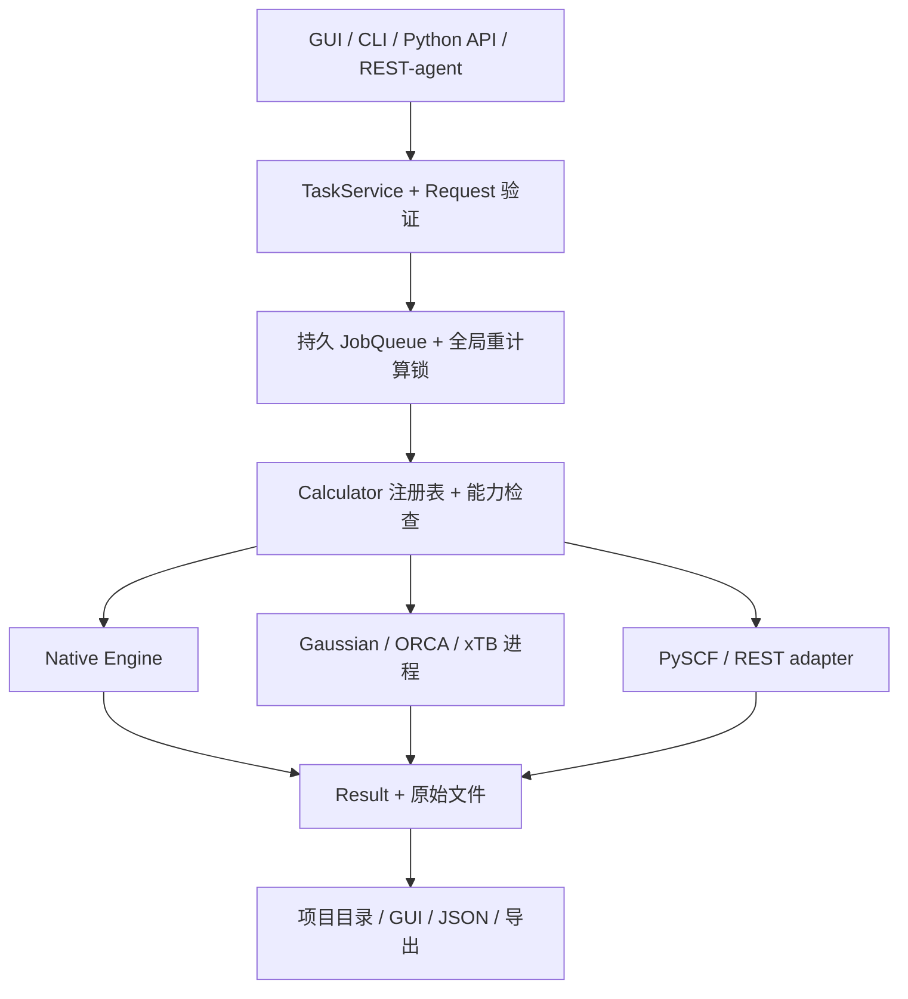

# 最终产品框架、语言技术栈和契约

## 1. 产品形态

CalChem 是 Windows 本地研究工作台：用户在同一项目中导入/编辑分子、选择精确方法与后端、排队串行计算、查看结构化结果及原始日志、导出科研数据。CLI、Python API、GUI 共用同一个任务服务和能力注册表。自然语言 REST-agent 后续通过 API 调用；它不决定科学方法的默认替换。



依赖方向：界面和 CLI → `api` → `jobs/core` → `backends` → 原生内核或外部程序。原生 `scf/integrals/dft` 不依赖 GUI/CLI；backend 不解析 UI 状态。`Result` 是任务结果的唯一持久契约，raw log 是证据。

## 2. 明确技术栈

| 范围 | v1.0 选择 | 安装/部署边界 |
|---|---|---|
| 原生内核/API | CPython 3.10+、NumPy、SciPy；保留现有 GTO/SCF/DFT/Post-HF 实现 | 原生功能可无商业程序工作；固定版本的 Windows 构建环境 |
| 统一契约/配置 | Pydantic v2、标准库 `json`、`pathlib`、`logging` | Request/Result/Config 有 schema 版本与迁移；不得 silent parse error |
| CLI | Click + Rich | `--json` stdout 只 JSON；进度/日志 stderr，错误码稳定 |
| 桌面 UI | PyQt6 + Matplotlib（现有方向）；大分子视图性能瓶颈后再考虑 pyqtgraph/独立 3D viewer | 单一 Qt binding，界面主线程；worker/队列做耗时任务 |
| 外部结果解析 | cclib 可选 extra + 每后端小范围专用终止/收敛检查 | Gaussian 16/ORCA 6.1.1 真实 fixture；cclib 对 ORCA 6.1.1 不作无证假设 |
| PySCF | optional extra，Python 对象直接映射 | 首版 RHF/UHF/RKS/UKS/MP2 中实测的子集；未装不影响 native |
| xTB | 本机可执行程序、subprocess，无 shell | 首版 GFN2-xTB 单点；无 binary 显示未配置 |
| RESTBackend | 按作者 REST 量化程序真实协议写 adapter | 没有 schema/endpoint 时保持 unavailable；REST-agent 用 API 而不是混入 backend |
| 测试/静态检查 | pytest、Ruff、mypy（公开 API）、pytest-cov | 正式测试对失败 assert；heavy/external 串行且本机手动 gate |
| Windows 打包 | PyInstaller one-folder，PowerShell 7 构建脚本 | 在 Windows 构建，venv/build/data/cache 位于 D/E 盘；商业软件不随包分发 |
| 项目存储 | `.calchem` 目录 + JSON/XYZ/log；原子写入 | 本地可复制、可恢复；v1 不引入服务端数据库 |

**库策略：** 重建 `pyproject.toml` 的 core、gui、external、pyscf、dev extras；锁定 Windows 发布环境的确切版本；仅在完整源码导入核查后移除旧声明。不要让 `PySCFBackend` 继承外部程序基类。单机 MVP 不加 Hydra、Celery、数据库、Web 前端、Docker/WSL 强依赖。

## 3. 模块目标目录

```text
calchem/
  __init__.py; __main__.py; cli.py
  core/{request.py,result.py,calculator.py,capabilities.py,errors.py,units.py,periodic_table.py}
  api/{service.py,high_level.py}
  jobs/{models.py,queue.py,dispatcher.py,global_lock.py,store.py,events.py}
  backends/{native.py,external.py,gaussian.py,orca.py,pyscf.py,xtb.py,rest.py,parsers/}
  config/{models.py,loader.py,doctor.py}
  io/{input.py,output.py,project.py,manifest.py}
  mol/ basis/ integrals/ scf/ dft/ post_hf/ grad/ opt/ vib/ props/ md/
  workflows/{engine.py,opv.py,reorganization.py,batch.py,gromacs.py}
  gui/{main_window.py,worker.py,project_panel.py,job_panel.py,molecule_view.py,
       settings.py,diagnostics.py,results/}
tests/{unit,numerical,parser,external,opt,vib,dft,workflows,gui,release}/
docs/{methods,backends,formats,gui,cli,science,release}/
scripts/{build_windows.ps1,run_acceptance.ps1,hash_release.ps1}
pyproject.toml; calchem.spec; requirements/...
```

旧文件保持路径兼容，逐项迁移；`calchem/tests/` 仍保留。根目录的历史 debug/scratch 排除在正式 pytest 收集之外。

## 4. 公共接口与结果语义

标准入口目标签名：

```text
TaskService.run(request: CalculationRequest) -> Result
TaskService.submit(request: CalculationRequest) -> Job
TaskService.get_job(job_id: str) -> Job
TaskService.cancel(job_id: str) -> CancelOutcome
TaskService.list_backends() -> list[BackendCapabilities]
Calculator.single_point(request: CalculationRequest) -> Result
Calculator.optimize(request: CalculationRequest) -> Result
Calculator.frequency(request: CalculationRequest) -> Result
```

这些是目标接口说明，不是可粘贴的完整实现。`TaskService.run` 必须获取全局重计算锁，`submit` 必须进入持久队列；Dispatcher 调用受锁保护的同一路径。`BackendCapabilities` 只列已经实现并经过相应版本/方法验证的 task-method-basis 组合，不能仅以“包/EXE 存在”判定可用。

`CalculationRequest` 必需：任务类型、分子、method/basis/backend、最终生效 resource limits、项目/job 标识、schema 版本。`MoleculeSpec` 为 Å 坐标快照；输入验证除电子数/多重度外，还要在 native backend 检查该元素有相应基组。后端配置可补默认参数，但保存请求前要把最终值固化。

`Result` 必需：schema 版本、输入快照与 hash、requested 和 actual method/basis、backend 和真实版本、status、时间、总能/SCF 能分别表示、单位、warnings/errors、run dir/relative raw paths。MP2/CCSD(T) 用方法最终总能；无能量写 null，不能把 0 或 SCF 参考能当高阶总能。不同后端没有的 orbital/gradient/IR 字段保持 null。失败也保存 Result 与原始日志。

**Result v1→v2 迁移：** 新字段可选加在 schema v1 的小版本，仅当字段含义改变时升大版本；保留旧项目读取适配器，旧历史结果无法确认总能方法时标记 `unverified_legacy_energy`，不能静默重解释。

## 5. 机器级重计算锁

使用同一个可配置非 C 盘路径 `D:\CalChemData\locks\heavy.lock`。Windows 用 `msvcrt.locking` 对文件首字节作非阻塞独占锁并保持文件描述符到任务退出；Linux CI 用 `fcntl.flock`。锁文件旁写 `heavy.json`，仅用于诊断，含 PID、job ID、启动时间和程序名；**PID 不是锁真值**，锁释放后方可检查/清理诊断元数据。锁路径必须是所有 GUI/CLI/API 实例共用的全局配置，不允许因 project/data_root 不同而自动分叉。`run()` 无论成功、异常、取消都在 `finally` 释放；等待中的 job 留在队列。跨进程双实例启动测试必须证明峰值为 1。

## 6. 资源预算与能力边界

- 一个 heavy job；每任务 CPU 上限 8，内存预算默认低于机器可用内存，Gaussian/ORCA 核数与每核内存按各自格式换算。禁止多个 heavy tests 并行。
- native 大基组/大分子需要依据 basis 函数数做内存估算和拒绝/警告；8 GB 显卡不能被视为 GPU 能力证明。
- 无网络可运行核心应用；REST 可选网络访问需要用户设置 endpoint 和凭据；密钥存放在安全配置/OS 凭据区，不写入 project manifest。
- 只有完整力场参数存在时才能导出可运行 GROMACS topology；RESP 电荷本身不是力场。

## 7. v1.0 最小能力集

| 功能 | 最低验收 |
|---|---|
| 原生 | H2/He/Ne/H2O/CH3 的明确方法与基组基线；RHF/已验证 DFT 单点；RHF 水分子优化与频率路径 |
| Gaussian/ORCA | 各自真实单点；同一方法的水分子 Opt/Freq 至少一条完整端到端链路；解析和状态准确 |
| PySCF/xTB | 可选安装，最小单点真实可用；未配置时没有可用假象 |
| 项目/队列 | 可保存重开、两任务顺序运行、跨 GUI/CLI 进程锁、失败日志可查 |
| GUI/CLI/API | 共享 TaskService；GUI 分子/配置/队列/结果/设置；CLI JSON；API schema 文档 |
| OPV | 一个许可明确的中型测试体系能跑分阶段 workflow；四能量重组能正确；GROMACS 输出仅在参数完整时可读入 |
| 发布 | Windows one-folder ZIP 干净环境运行；版本锁、SHA-256、验收报告与限制同步 |

RESTBackend 若无实际程序协议，状态为 BLOCKED 且 UI 禁用；这不妨碍其余成熟平台作为 v1.0 发布，但发布说明必须明确该能力尚不可用。原生 M06-2X/ωB97X-D 不属于 v1.0 最小承诺；可以经成熟后端调用，并记录真实方法。
