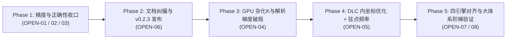

# CalChem 全量问题台账与分阶段推进总规划

> **生效日期**：2026-11-23  
> **强制前置约束**：本规划下的一切研发、测试、基准对比与汇报，必须无条件遵守仓库根目录最高执行铁律 [AGENTS.md](file:///E:/YDW/Trae_Gaussian/AGENTS.md)。

---

## 1. 当前真实基线与能力边界（客观盘点）

### 1.1 版本与交付状态
| 状态层级 | 当前真实状态 | 说明 |
|---|---|---|
| **线上已发布 (`v0.2.2`, Git `9f57bd7`)** | **2026-11-19 旧版** | 存在咖啡因四引擎审计暴露的 17 项 P0/P1 工程与精度缺陷；GitHub / npm 尚未更新（PyPI / `calchem-py` 已从工作区剥离）。 |
| **本地工作区（未提交）** | **2026-11-24 Phase 1 闭环 + Phase 2 单哈希终验完成版（待提交与发版）** | 已完成 `OPEN-01`/`OPEN-02`/`OPEN-03` 底层修补与终版单哈希验收、`calchem-py`/PyPI 剥离、`npm/` 原生 CLI 解耦与文档纠偏；全量 Rust 测试 **160 passed, 0 failed, 1 ignored**（72 suites）；冻结 Release 二进制 `build_target/release/calchem_cli.exe`（`7,594,496` bytes，SHA256: `C00AB91FF8DEB26675D4819FCDB868E429BCDF3976B60FEFDF39BA965D1C9D46`）已完成三项统一单哈希终验并全部落盘至 `D:\YDW\Calc\qc_benchmark_runs\pilot\v023_final_C00AB91F\summary.json`；**当前仍仅本地未提交、未推送 GitHub / npm**。 |

### 1.2 真实长板 vs 真实短板（不夸大、不贬低）
- **✅ 真实长板（源码与实测已验证）**：
  1. **纯 Rust 科学底座扎实**：14 个核心 crate 生产代码 `0 panic!`、`0 todo!`，精确积分下 `RHF/B3LYP/CAM-B3LYP/wB97X-D` 与 Gaussian 16 精度对齐（24 原子咖啡因 `B3LYP-D3BJ/6-31G(d,p)` 实测仅差 **`+0.0082 kcal/mol`**）。
  2. **已有 67 KB 手写 FP64 CUDA 核函数**（[cuda_kernels.cu](file:///E:/YDW/Trae_Gaussian/crates/calchem-cuda/src/cuda_kernels.cu)）：完整覆盖 **GPU 3 中心积分（含 S/P/D 轨，$10^{-14}$ 精度）、GPU RI-J 缩并、GPU DFT 格点 $V_{\text{xc}}$**，搭配 SAD 初猜 + Level Shifting，在 **纯泛函（PBE/BLYP）+ GPU RI-J 单点** 赛道具备真实速度与内存优势。
  3. **多任务工程链路今日已补齐契约**：统一 D3BJ（energy/grad/opt/freq）、严格参数/内存前检、AO-Direct TD-DFT（TDA + Full LR/RPA）、原子 JSON、优化步级日志与原子续算 checkpoint、频率位移缓存。
- **⚠️ 真实短板（后续集中攻坚对象）**：
  1. **GPU 尚未覆盖杂化泛函精确交换 $K$、TD-DFT、解析梯度及 F-shell RI-J 3c**：即便开启 `--gpu`，3c 积分遇到极化基组 F 辅助壳层（`L_aux > 2`）仍回退 CPU（已真实计入 `gpu_fallback_invocations`），`B3LYP` 精确交换 $K$、Full-LR TD-DFT 与解析梯度也仍在 CPU 运行（纯 CPU 咖啡因单点 265s vs G16 31.5s，8 核 Full-LR TD-DFT 5119.9s vs G16 192.2s，慢约 26.6x）。
  2. **RI-J 在极小基组 `STO-3G` 仍存在 `-4.1 kcal/mol` 误差**（`IC-2F / STO-3G`：`auto-jfit` `-4.08`、`def2-jfit-f` `-4.58 kcal/mol`）；极化基组 `6-31G(d)` / `6-31G(d,p)` 已收口至 `< 0.1 kcal/mol`。
  3. **开壳层 `UB3LYP` 与溶剂化小幅残差**：`UB3LYP` 因采用 VWN 公式 V 与 G16 VWN3 存在约 `0.14 kcal/mol` 绝对气相能差（闭壳层与 $\Delta G_{\text{solv}}$ 差值不受影响）；PCM 默认用 `Bondi (alpha=1.20)` 而非 G16 `UFF (alpha=1.10)`；`ethanol/DMSO` SMD CDS 符号偏差待复核。
  4. **优化器仍为笛卡尔 BFGS**：缺少冗余内坐标（DLC）优化器，收敛步数偏多（Python 旧空壳 `calchem/opt/berny.py` 已随方案 A 剥离删除）。
  5. **中大体系极化基组全任务尚未完成端到端实测**：72 / 94 / 199 / 726 原子需按铁律补齐真实收敛（或显式预算拒算）的落盘证据。

---

## 2. 全部已知问题总台账

### 2.1 已在本地工作区修复并实测通过（待提交与发版）

| 编号 | 原问题 | 本地修复内容 | 实测验证证据 |
|---|---|---|---|
| **P0-01** | CLI 仅单点加 D3，`grad/opt/freq` 不一致；`wB97X-D` 易双重色散 | 统一 `D3Model` 贯穿四任务；拆分 `Wb97x` 与 `Wb97xd`；拒绝 `wB97X-D + --disp` | `cargo test -p calchem-cli --test cli_contracts`（D3BJ 中心差分梯度闭环通过） |
| **P0-02** | 非法参数/未知溶剂/超内存静默忽略或误报基组不支持 | 严格参数校验与 SCF 前拦截；超 4 GB 自动切 Direct；显式 `--stored` 报 `ResourceLimit`；失败不写假 JSON | `cli_contracts` 10 项非法输入拒绝测试全通过 |
| **P0-03** | CLI 激发态写死 TDA singlet；260 AO 咖啡因 Stored ERI 9.9 GB 爆内存 | 暴露 `--td-mode <tda\|lr>`、`--spin`、残差检验；新增 `build_k_general_with_omega` 与 **AO-Direct TD-DFT** | `direct_fock_numerical` 5/5、`tddft_and_cis` 5/5（Direct vs Stored `< 1e-6 eV`） |
| **P0-04** | JSON 缺状态/几何哈希/轨道信息，写入非原子 | 统一结构化 JSON 契约 + 临时文件原子替换；新增单任务强校验脚本 [verify_calchem_job.py](file:///E:/YDW/Trae_Gaussian/scripts/verify_calchem_job.py) | `cli_contracts` 全通过 |
| **P0-05** | Opt 无步级进度、无持久化检查点，中断后无法续跑 | 新增每步实时 stderr 日志、原子 checkpoint（含二进制/模型哈希）、`--resume` 校验与续算 | `cli_contracts` 中断续算位级一致 + 失配拒绝通过；咖啡因 2 步实跑验证 |
| **P1-01 (阶段1)** | Opt 接受步重复跑 SCF、冷启动试探、梯度缺预筛且 9 倍重复 Boys/VRR | `GasPoint` 波函数复用；相邻几何 Löwdin 轨道投影初猜；单遍四中心梯度导数 + 密度加权 Schwarz 预筛 | 咖啡因 8 核单步梯度 `648s -> 214s`（**3.02x 提速**，梯度值完全一致）；`calchem-grad` 15/15 通过 |
| **P1-03** | Freq 重复构网格、缺乏并发上限与断点续算 | 修复双网格构造；新增 `--freq-jobs` 限流与 `--checkpoint <dir>` 逐位移原子缓存 | `cli_contracts` 位移缓存复用通过；`calchem-vib` 全通过 |
| **P1-04** | 咖啡因单点 `-6.87 kcal/mol`；`sp_fine_exact` 100 步不收敛 | 归因 `-6.52 kcal/mol` 来自 `auto-jfit`；收紧 Direct SCF 筛选阈值 `1e-10 -> 1e-12` | `D:\YDW\Calc\qc_benchmark_runs\pilot\calchem_postfix_20261123_1795435704\summary.json`：**`sp_fine_exact` 20 步收敛，`dE_G16 = +0.0082 kcal/mol`** |

---

### 2.2 尚未闭合的待办问题（按优先级排序）

| 编号 | 优先级 | 问题描述 | 根因 / 现状 | 关单验收标准 |
|---|---|---|---|---|
| **OPEN-01** | **P0（单哈希终验已闭环）** | 默认 `--aux-basis auto-jfit` 对极化基组精度超标 | 重构 per-$L$ AutoAux 辅助基组构造并加测 F-shell GPU 回退如实计数；极化基组 `6-31G(d)` / `6-31G(d,p)` SP `< 0.1 kcal/mol`、梯度 `< 5e-5 Eh/Bohr`（咖啡因 `-0.0938 kcal/mol`、`trunc=0`） | **已通过终版单哈希验收（`C00AB91F...`）**：`rij_precision_probe` 3/3 绿；咖啡因 8 核纯 CPU 复验 [open01_caffeine_autojfit/manifest.json](file:///D:/YDW/Calc/qc_benchmark_runs/pilot/v023_final_C00AB91F/open01_caffeine_autojfit/manifest.json) `status="verified"`、`exit_code=0`、`rij_metric_truncated_modes=0`、`dE_G16 = -0.0856 kcal/mol`（`94.89 s`）；**明示边界**：`IC-2F/STO-3G` 极小基组仍存在 `-4.08 kcal/mol` 误差 |
| **OPEN-02** | **P0（Blocker-2 单哈希终验已关闭；纯 CPU 提速归口 Phase 3）** | 咖啡因 AO-Direct Full-LR TD-DFT 与 Gaussian 16 对齐及纯 CPU 耗时 | 冻结二进制 `C00AB91F...` 8 核纯 CPU 终验 5 根 S1–S5 与 G16 `td.log` 偏差 **`-0.000063` 至 `-0.000246 eV`**（全部 `<= 0.001 eV`），全部收敛（最大残差 `8.468e-07 Eh`），实测耗时 **`5119.86 s`（~85.3 min，较 G16 `192.2 s` 慢 ~26.6x）** | **Blocker-2 精度与收敛验收已关闭**：[open02_caffeine_tddft_lr/manifest.json](file:///D:/YDW/Calc/qc_benchmark_runs/pilot/v023_final_C00AB91F/open02_caffeine_tddft_lr/manifest.json) `status="verified"`、`exit_code=0`、几何 `1acd5f86...` 严格对齐 [td.log](file:///D:/YDW/Calc/qc_benchmark_runs/pilot/gaussian/td.log)；纯 CPU 提速归口 Phase 3（`OPEN-04`） |
| **OPEN-03** | **P0（单哈希终验已闭环）** | 溶剂化（PCM/SMD）$\Delta G_{\text{solv}}$ 符号/拆项与梯度势能面分裂 | 已修复 `BoundaryMatrix` Cholesky 全局偏移与 York-Karplus 核 / `IEF-PCM` / `SmdIntrinsic` / 默认纯静电与不强行重归一化；23/23 算例对齐 G16 至 `0.002–0.318 kcal/mol`；已重构 `gradient.rs` 统一走 `ReactionFieldSolver` + `compute_cds_energy` 并补齐 `matrix.rs` / `scrf.rs` 修复；冻结二进制 `C00AB91F...` 关键 8 算例 4 核纯 CPU 复验全收敛且与前次 `0.000000 kcal/mol` 一致 | **已通过终版单哈希复验（`C00AB91F...`）**：`pcm_and_scrf` 8/8 通过；关键 8 算例落盘 [open03_final_summary.json](file:///D:/YDW/Calc/qc_benchmark_runs/pilot/v023_final_C00AB91F/open03_final_summary.json)（与 G16 偏差 `-0.186` 至 `+0.318 kcal/mol`）；明示默认 `Bondi(1.20)` 与 G16 `UFF(1.10)`、`UB3LYP` VWN5/VWN3 差异及 `ethanol/DMSO` SMD CDS 符号偏差待复核 |
| **OPEN-04** | **P1** | 杂化泛函精确交换 $K$、TD-DFT、解析梯度与 F-shell RI-J 3c 未上 GPU | CUDA 目前仅覆盖 RI-J `L <= 2` 3c（极化 F-shell 回退 CPU）、缩并与 DFT $V_{\text{xc}}$ | ① 补完同条件 8 核 **CPU vs GPU** 阶段耗时剖析；② 落地 **GPU 解析梯度**、TD-DFT 与 **交换 $K$ 加速（先守精度门禁）** |
| **OPEN-05** | **P1** | 优化器为笛卡尔 BFGS，缺少冗余内坐标（DLC） | 旧 Python 空壳 `calchem/opt/berny.py` 已随方案 A 剥离删除；Rust `calchem-opt` 为笛卡尔 BFGS/P-RFO | 在 `calchem-opt` 实现真实 DLC + 信赖域 RFO；咖啡因完整 Opt 收敛步数实测下降且驻点 Freq 0 虚频 |
| **OPEN-06** | **P1（单哈希终验与文档纠偏已落地，待提交与发版）** | 文档漂移、Py/Rust 双轨分裂、本地未提交、线上仍为旧版 `v0.2.2` | 已按方案 A 彻底剥离 `calchem-py`/PyPI、`npm/` 解耦为纯原生 CLI 包装器、重写 [README.md](file:///E:/YDW/Trae_Gaussian/README.md) 与 [NATIVE_METHOD_BOUNDARIES.md](file:///E:/YDW/Trae_Gaussian/docs/NATIVE_METHOD_BOUNDARIES.md)；冻结版 `calchem_cli.exe`（`C00AB91F...`）三项单哈希终验已全部落盘于 [summary.json](file:///D:/YDW/Calc/qc_benchmark_runs/pilot/v023_final_C00AB91F/summary.json) | 仅剩拆分清晰 Git commit、推送 GitHub 与 npm 并打 `v0.2.3` tag |
| **OPEN-07** | **P2** | Pueue 守护离线 + 第三方对照（ORCA 160/161、REST、G16 5D/6D）未闭环 | 11/22 重启后 Pueue 未拉起，ORCA 诊断未跑，REST 频率失败未归因 | 恢复 Pueue（2×4 核上限）与重启自检；补完同条件 8 核四引擎对照表 |
| **OPEN-08** | **P2** | 中大体系（94 / 199 / 726 原子）极化基组真实内存与耗时缺实测 | 过去仅跑过小分子或 STO-3G/PBE 或半途被杀 | 按 `24 -> 94 -> 199 -> 726` 阶梯实测，落盘完整收敛 JSON + 峰值 RSS/VRAM，绝不半途 kill 充数 |

---

## 3. 分阶段推进路线图（硬门禁驱动，不达标不进下一阶段）

### Phase 1：精度与物理正确性收口（已完成冻结二进制 `C00AB91F...` 单哈希闭环验收）
1. **OPEN-01（RI-J 默认辅助基组与 GPU 回退计数修复）**：✅ 冻结二进制 `C00AB91F...` 单哈希复验通过（`dE_G16 = -0.0856 kcal/mol`、`trunc=0`、`94.89 s`，[manifest.json](file:///D:/YDW/Calc/qc_benchmark_runs/pilot/v023_final_C00AB91F/open01_caffeine_autojfit/manifest.json)），`rij_precision_probe` 3/3 绿；`STO-3G` `-4.08 kcal/mol` 已入边界文档。
2. **OPEN-02（咖啡因 AO-Direct Full-LR TD-DFT 实测）**：✅ 冻结二进制 `C00AB91F...` 单哈希验收关闭 Blocker-2（S1–S5 偏差 `-0.000063` 至 `-0.000246 eV`，最大残差 `8.468e-07 Eh`，实测耗时 `5119.86 s` / ~85.3 min，较 G16 `192.2 s` 慢 ~26.6x，[manifest.json](file:///D:/YDW/Calc/qc_benchmark_runs/pilot/v023_final_C00AB91F/open02_caffeine_tddft_lr/manifest.json)）；纯 CPU 提速归口 Phase 3。
3. **OPEN-03（溶剂化 $\Delta G_{\text{solv}}$ 拆项与梯度势能面统一）**：✅ 冻结二进制 `C00AB91F...` 关键 8 算例 8/8 收敛且与前次偏差 `0.000000 kcal/mol`（[open03_final_summary.json](file:///D:/YDW/Calc/qc_benchmark_runs/pilot/v023_final_C00AB91F/open03_final_summary.json)）；`23/23` G16 对齐、`pcm_and_scrf` 8/8 通过；明示 `Bondi(1.20)` vs `UFF(1.10)`、`UB3LYP` VWN5/VWN3 及 `ethanol/DMSO` SMD CDS 边界。

### Phase 2：文档纠偏、方案 A 剥离与 `v0.2.3` 诚实发布（进行中）
1. ✅ 已重写 [README.md](file:///E:/YDW/Trae_Gaussian/README.md) 与 [NATIVE_METHOD_BOUNDARIES.md](file:///E:/YDW/Trae_Gaussian/docs/NATIVE_METHOD_BOUNDARIES.md)，严格按 [AGENTS.md](file:///E:/YDW/Trae_Gaussian/AGENTS.md) 清除夸张措辞并明示 5 项真实边界。
2. ✅ 已执行方案 A 彻底剥离 `calchem-py` / PyPI，并将 `npm/` 解耦为纯原生 `calchem_cli` 包装器；全工作区 `cargo test --workspace --no-fail-fast --jobs 4` **160 passed, 0 failed, 1 ignored**。
3. ✅ 已完成冻结二进制 `C00AB91F...` 三项统一单哈希实跑复验并汇总落盘至 [summary.json](file:///D:/YDW/Calc/qc_benchmark_runs/pilot/v023_final_C00AB91F/summary.json)；⏳ 待拆分清晰 Git commit、推送 GitHub/npm 并发布 `v0.2.3`。

### Phase 3：GPU 全链路扩展（把 RTX 5060 Ti 真正打到杂化泛函与梯度）
1. 先在同一台机器、同样 8 线程下，跑通 **咖啡因 `B3LYP-D3BJ/6-31G(d,p)`：纯 CPU vs 开启 `--gpu`** 的详细分阶段 Profile（精确量化 `1e / RI-J / K / V_xc / grad` 每一项的真实耗时）。
2. **解析梯度上 GPU**（先做 `V_xc` 梯度与 RI-J 3c 梯度核，再评估 4c-K 梯度核），每步必须先通过数值有限差分精度验证（`< 1e-6 Eh/Bohr`）。
3. **杂化精确交换 $K$ 提速**（评估 GPU Direct-K / RI-K / COSX），严格以咖啡因精确 4c 能量为基准，精度差控制在 $\le 0.1\text{ kcal/mol}$ 内再计入加速。
- **Phase 3 出口门禁**：咖啡因 `B3LYP-D3BJ/6-31G(d,p)` 单点与梯度在守住精度门禁的前提下实现数量级提速，且所有 GPU 核均有 CPU 解析参考单测。

### Phase 4：冗余内坐标（DLC）优化器与完整 Opt+Freq 闭环
1. 在 `calchem-opt` 实现标准 Wilson $B$ 矩阵 + 冗余内坐标（DLC）+ 信赖域步骤，替换笛卡尔 BFGS（legacy `calchem/opt/berny.py` 已随方案 A 删除）。
2. 实跑咖啡因完整 `Opt -> Freq` 闭环，核查优化后能量、梯度与 **0 虚频**，与 Gaussian 16 对比步数和耗时。
- **Phase 4 出口门禁**：咖啡因完整 Opt 收敛且驻点 Freq 无虚频，落盘可复现。

### Phase 5：四引擎完整对齐与大体系阶梯验证
1. 拉起 Pueue（并发 2×4 核），补完 Gaussian 16（5D/6D）、ORCA（160/161 诊断）、REST、CalChem 四引擎同条件对照。
2. 按 `24 原子（咖啡因）-> 72 原子（PTQ10）-> 94 原子 -> 199 原子（BTP-4F）-> 726 原子（p4D18）` 阶梯实测单点/梯度/短优化，如实记录每一档的真实收敛结果、耗时、峰值 RSS/VRAM 与失败边界。

---

## 4. 下一步执行起点

按当前进度，**已完成冻结二进制 `C00AB91F...` 单哈希终验，下一步为 Phase 2 提交与 `v0.2.3` 发版**：
1. ✅ 终版 Release `calchem_cli.exe`（SHA256: `C00AB91FF8DEB26675D4819FCDB868E429BCDF3976B60FEFDF39BA965D1C9D46`）已完成 `OPEN-01` / `OPEN-02` / `OPEN-03` 统一单哈希落盘验收（[summary.json](file:///D:/YDW/Calc/qc_benchmark_runs/pilot/v023_final_C00AB91F/summary.json)）；
2. ⏳ 按逻辑拆分清晰 Git commit 并推送 GitHub，同步更新 `@yangdw2024/calchem` npm CLI 包并发布 `v0.2.3`；
3. 发布收口后进入 Phase 3（`OPEN-04`：GPU 杂化 $K$ 与解析梯度）。
