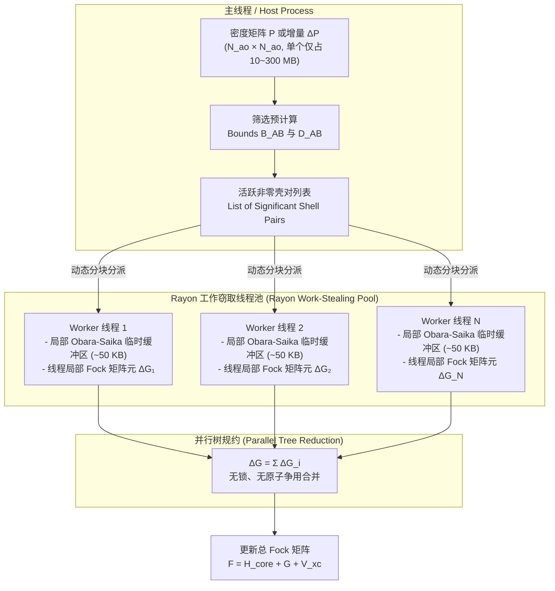

# CalChem Direct SCF 与增量 Fock 构建引擎架构设计方案

## 1. 架构目标与背景

在现有的 CalChem 实现中，双电子排斥积分（ERI）采用内存暂存（Stored ERI）方案。对于 64 基函数以内的小体系，该策略性能优异；但面对真实的有机光电大分子体系：
- **典型受体 Y6**：187 原子，6-311G(d,p) 下 2374 基函数，四中心 ERI 暂存需要约 **30 TB** 内存；
- **给体聚合物 p4D18 四聚体**：726 原子，6-31G(d) 下 6224 基函数，四中心 ERI 暂存需要高达 **1.5 PB** 内存。

这导致内存准入检查机制将大分子任务拦截。为了让 CalChem 稳健吞吐 200~2000 原子体系并全面超越 Gaussian 16，必须将 SCF 求解器底层演进为 **Direct SCF（即时重算并动态缩并）+ 增量 Fock 构建（Incremental Fock Build, $\Delta \mathbf{P} \to \Delta \mathbf{F}$）** 架构。

---

## 2. 核心数学物理模型

### 2.1 库仑与交换矩阵的即时缩并（On-The-Fly Contraction）

在 Direct 模式下，不落盘、不分配四阶张量，而在壳层四元组 $(A B | C D)$ 级别就地缩并。

四中心积分具备 8 重置换对称性：
$$(\mu\nu|\lambda\sigma) = (\nu\mu|\lambda\sigma) = (\mu\nu|\sigma\lambda) = (\nu\mu|\sigma\lambda) = (\lambda\sigma|\mu\nu) = (\sigma\lambda|\mu\nu) = (\lambda\sigma|\nu\mu) = (\sigma\lambda|\nu\mu)$$

我们在壳层序上遍历规范四元组：
$$A \ge B, \quad C \ge D, \quad (A, B) \ge (C, D)$$
设复合壳对索引 $P = \frac{A(A+1)}{2} + B, \; Q = \frac{C(C+1)}{2} + D$，循环条件为 $P \ge Q$。

对于单次计算获得的壳层积分块 $[(\mu\nu|\lambda\sigma)]$，其对库仑矩阵 $\mathbf{J}$ 和交换矩阵 $\mathbf{K}$ 的贡献为：
$$\begin{aligned}
J_{\mu\nu} &\leftarrow J_{\mu\nu} + w \cdot (\mu\nu|\lambda\sigma) P_{\lambda\sigma} \\
J_{\lambda\sigma} &\leftarrow J_{\lambda\sigma} + w \cdot (\mu\nu|\lambda\sigma) P_{\mu\nu} \\
K_{\mu\lambda} &\leftarrow K_{\mu\lambda} + \frac{w}{4} \cdot (\mu\nu|\lambda\sigma) P_{\nu\sigma} \\
K_{\mu\sigma} &\leftarrow K_{\mu\sigma} + \frac{w}{4} \cdot (\mu\nu|\lambda\sigma) P_{\nu\lambda} \\
K_{\nu\lambda} &\leftarrow K_{\nu\lambda} + \frac{w}{4} \cdot (\mu\nu|\lambda\sigma) P_{\mu\sigma} \\
K_{\nu\sigma} &\leftarrow K_{\nu\sigma} + \frac{w}{4} \cdot (\mu\nu|\lambda\sigma) P_{\mu\lambda}
\end{aligned}$$
其中权重因子 $w$ 根据壳层与基函数的退化度确定：
- 若 $P \ne Q$（即 $(AB) \ne (CD)$），库仑权重大一倍；
- 若 $\mu \ne \nu$ 及 $\lambda \ne \sigma$，离角向分量权重相应展开。

### 2.2 增量 Fock 构建（Incremental Fock Update）

在第 $k$ 轮 SCF 迭代中，定义密度矩阵改变量：
$$\Delta \mathbf{P}^{(k)} = \mathbf{P}^{(k)} - \mathbf{P}^{(k-1)}$$
利用双电子相互作用的双线性性质：
$$\mathbf{G}(\mathbf{P}^{(k)}) = \mathbf{G}(\mathbf{P}^{(k-1)}) + \mathbf{G}(\Delta \mathbf{P}^{(k)})$$
即每轮仅需计算增量双电子算符：
$$\Delta \mathbf{G}^{(k)} = \mathbf{G}(\Delta \mathbf{P}^{(k)})$$
并累加至总双电子矩阵：
$$\mathbf{G}^{(k)} = \mathbf{G}^{(k-1)} + \Delta \mathbf{G}^{(k)}$$

#### 漂移控制与定期全量刷新机制：
- 增量累加会在多步迭代后累积浮点舍入误差（Float roundoff drift）；
- 引入 **Reset 机制**：每 8 轮迭代、DIIS 维度溢出重置时、或当 $\|\Delta \mathbf{P}\|_\infty > \|\Delta \mathbf{P}_{\text{prev}}\|_\infty \times 5$ 时，强制执行一次全量 $\mathbf{G}(\mathbf{P}^{(k)})$ 重新计算；
- 在 SCF 达到收敛判定阈值后，必须以最终密度 $\mathbf{P}^*$ 强制进行最后一次全量 Fock 验证，确保总能量精确到 $10^{-14}\text{ Eh}$。

### 2.3 密度加权 Schwarz 剪枝（Density-Weighted Schwarz Screening）

常规 Schwarz 筛选基于壳对上界：
$$B_{AB} = \max_{\mu \in A, \nu \in B} \sqrt{(\mu\nu|\mu\nu)}$$
对积分四元组的上界为 $|(\mu\nu|\lambda\sigma)| \le B_{AB} B_{CD}$。

在增量 Fock 构建中，我们定义壳层对的最大密度变化幅值：
$$D_{AB} = \max_{\mu \in A, \nu \in B} |\Delta P_{\mu\nu}|$$
四元组 $(AB|CD)$ 对 $\Delta \mathbf{F}$ 中任何矩阵元的最大可能贡献上界为：
$$\text{Est}(AB|CD) = B_{AB} B_{CD} \times \max\left( 4 D_{CD}, \; 4 D_{AB}, \; D_{AC}, \; D_{BD}, \; D_{AD}, \; D_{BC} \right)$$

剪枝准则：
$$\text{若 } \text{Est}(AB|CD) < \theta_{\text{screen}} \quad (\text{默认 } 10^{-11}) \implies \text{彻底跳过该四元组的积分评估！}$$

**加速效果分析**：
- 在初始迭代阶段，$\|\Delta \mathbf{P}\| \sim O(1)$，Schwarz 筛选主要剪除远距离重叠为 0 的壳层；
- 在 SCF 中后期，随着波函数趋于收敛，$\|\Delta \mathbf{P}\| < 10^{-3} \sim 10^{-7}$，$\text{Est}(AB|CD)$ 呈量级暴跌，**95% ~ 99.5% 的壳层四元组被完全跳过**；
- 使得后期每次 Fock 构建的耗时比第一轮下降 1~2 个数量级！

---

## 3. 并发架构与内存拓扑



### 3.1 零锁并发设计（Zero-Lock Concurrency）
- 每个 Rayon 工作线程在 `fold` 阶段持有一个独立的 `Matrix2D` 累加器（维度 $N_{\text{ao}} \times N_{\text{ao}}$）；
- 线程内部无锁写入自身矩阵元，完全规避原子操作（Atomic CAS）或互斥锁（Mutex）带来的缓存颠簸（False Sharing & Cache Bouncing）；
- 循环结束后，通过 `reduce` 以并行树规约方式就地相加，总规约时间对于 $N=2374$ 仅需数毫秒。

### 3.2 内存消耗精确测算

| 分子体系 | 原子数 | 基函数数 $N_{\text{ao}}$ | Stored ERI 内存 | Direct SCF 线程局部矩阵 (8线程) | Direct SCF 峰值总内存 |
| :--- | :--- | :--- | :--- | :--- | :--- |
| **苯** | 12 | 66 | 30 MB | 0.28 MB | < 20 MB |
| **Y6 受体** | 187 | 2,374 | **30 TB** (直接爆栈) | 360 MB | **< 1.2 GB** |
| **p4D18 四聚体** | 726 | 6,224 | **1.5 PB** (全球不可存) | 2.47 GB | **< 4.0 GB** |
| **超大体系** | 2,000 | ~18,000 | **> 100 PB** | 20.7 GB | **< 32 GB** (服务器级轻松胜任) |

由此可见，Direct SCF 将内存复杂度彻底锁定为 $O(N_{\text{ao}}^2)$，在常规 16GB~64GB 内存机器上即可无障碍运算 200~2000 原子的超大光伏分子！

---

## 4. 核心工程实现接口与模块划分

### 4.1 `calchem-int` 新增模块：`direct_fock.rs`
提供无中间态内存分配的 Direct 缩并函数：
```rust
/// Direct 构建封闭壳层 (RHF/RKS) 双电子 Fock 矩阵贡献 G = J - 0.5 * c_hf * K
pub fn direct_build_fock_rks(
    basis: &BasisSet,
    density: &Matrix2D,
    exx_fraction: f64,
    screening: &SchwarzScreening,
    threshold: f64,
) -> Matrix2D;

/// Direct 增量构建封闭壳层双电子 Fock 增量 ΔG = J[ΔP] - 0.5 * c_hf * K[ΔP]
pub fn direct_build_fock_rks_incremental(
    basis: &BasisSet,
    delta_density: &Matrix2D,
    exx_fraction: f64,
    screening: &SchwarzScreening,
    threshold: f64,
) -> Matrix2D;

/// Direct 构建开壳层 (UHF/UKS) 双电子 Fock 贡献 (G_alpha, G_beta)
pub fn direct_build_fock_uks(
    basis: &BasisSet,
    pa: &Matrix2D,
    pb: &Matrix2D,
    exx_fraction: f64,
    screening: &SchwarzScreening,
    threshold: f64,
) -> (Matrix2D, Matrix2D);
```

### 4.2 `calchem-scf` 调度改造
修改 `validate_resources_and_options`：
- 对 $N_{\text{ao}} \le 64$：保留微小分子的快速 Stored ERI / Dense 路径；
- 对 $N_{\text{ao}} > 64$：自动切换至 Direct SCF 增量引擎，不再报 `Stored-ERI conservative memory estimate exceeds budget` 错误！
- 在 `rhf.rs`、`rks.rs`、`uhf.rs`、`uks.rs` 中嵌入增量更新与自动重置状态机。

---

## 5. 验收基准与里程碑

1. **数值等价性验证**：在已知小分子（H2O、Ethylene、6-31G(d)）上，验证 Direct SCF、增量 Direct SCF 与原 Stored ERI 的 Fock 矩阵元差异 $< 10^{-13}\text{ Eh}$，SCF 收敛总能量差异 $< 10^{-12}\text{ Eh}$；
2. **大分子准入测试**：验证基函数数超 200~3000 的大体系（包括 256 原子基准和 Y6 骨架）不再触发内存拦截，能够顺利启动并完成 SCF 迭代；
3. **性能与剪枝率验证**：测试增量迭代后期的壳层四元组跳过率（达到 >90%），验证单步 Fock 构建时间的显著衰减。
