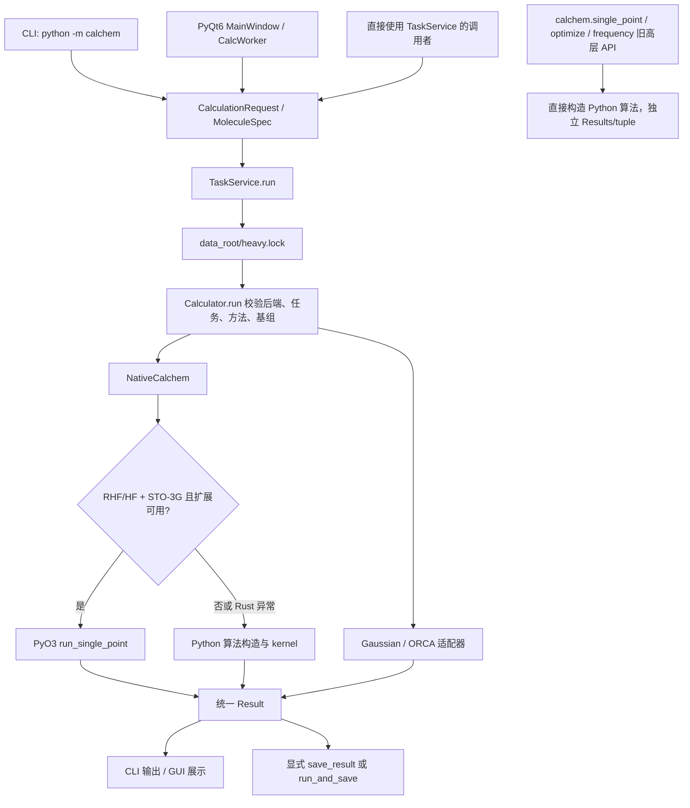
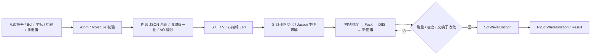

# 当前状态与逆向工作流

审计日期：2026-11-03，Asia/Shanghai。项目：`E:\YDW\Trae_Gaussian`。

## 1. 当前到底到哪一步了

当前可定位为 **Rust Stage 2 的小体系 RHF 内核，加上尚未完全整合的 Python 计算工作站；Stage 3 仍处于设计阶段**。这不是已经全面替代 Gaussian 的完整量化软件。

本次确认 RHF/STO-3G 四个小体系单点能、Rust 的 H₂/H₂O 6-31G 路径，以及 Python 有限差分驱动的 H₂ 优化可以运行。但统一接口、外部程序适配、测试、版本和发布材料存在断层，不能根据历史“完成”记录判断当前已全部验收。

最直接的现状证据：

- Git 分支 `master`；HEAD `c9fd62e`；最后提交时间 2026-10-30 14:11:11 +08:00。
- 初始唯一未跟踪业务文件为 `CalChem_Stage3_Design.md`。它被完整保留并备份；设计不代表代码已实现。
- 当前没有配置 Git remote。`.github/workflows/ci.yml` 监听 main/develop 的 push 和 main 的 PR，当前 master 不在 push 范围；不能声称已有线上 CI 保障。
- 九个 Rust crates 中 `calchem-grad`、`calchem-opt`、`calchem-prop` 的 lib.rs 只有模块说明，没有功能实现。
- 当前 `calchem._core.pyd` 实际只导出 `PyScfWavefunction` 和 `run_single_point`；没有 `run_gradient`、`run_optimize`、零拷贝 cube。

## 2. 时间线：代码与记录如何走到当前结构

| 时间 | Git / 记录 | 实际阶段 |
|---|---|---|
| 2026-10-28 | b8397eb 至 30eb1fc | 保存 Python 基线；统一 Request/Result、Native/Gaussian/ORCA 后端、任务服务、CLI、PyQt6 GUI；历史记录称完成过 PyInstaller 打包 |
| 2026-10-28 | 89aa81d、479edea | 输入验证、避免伪造结果、JSON 输出、配置和调度补强 |
| 2026-10-29 | 6a44f65 至 30dc508 | 全局锁、解析工具、数值优化、数值频率及 Gaussian Opt/Freq；历史版本记录到 v0.6.0 |
| 2026-10-30 | 4da99f0、ee567ee | 开始 Rust workspace；s 型积分和 RHF |
| 2026-10-30 | 6fed3a1 | DIIS 和 Python/Rust 双轨路由 |
| 2026-10-30 | ced006b | Stage 2：OS 递推、p 型积分和 RHF 小体系验证 |
| 2026-10-30 | c9fd62e | 根目录清理、旧交接材料归档 |
| 2026-10-30 | 未跟踪 Stage 3 设计文件 | 解析梯度、Rust 优化和性能工作的设计；本次未发现对应实现 |
| 2026-11-03 | 本次审计 | 建立规划、证据、状态、问题、操作记录和备份恢复机制；业务源码保持原状 |

时间线依据 `evidence/git-history.txt`，文件时间仅作为补充。目录中存在更晚生成的 pyc，不能据此推断业务代码继续开发。

## 3. 目录边界：哪份代码真正运行

| 路径 | 当前角色 |
|---|---|
| `calchem/` | 实际 Python 运行包、统一服务/后端和旧算法实现 |
| `crates/` | 实际 Rust workspace 源码，共九个 crate |
| `tests/` | 正式测试与大量历史诊断脚本混合；目录名不能代表已形成自动验收 |
| `docs/BASELINE.md` | 10 月 28 日 Python 数值基线，部分精度说明需更新 |
| `CalChem_Stage3_Design.md` | 未提交的后续实现设计 |
| `_chatgpt_stage2/` | 交接快照，不是运行入口 |
| `_archive/` | 旧源码、蓝图、验收和 ZIP，共 2255 个文件；不应当作当前实现 |
| `CalChem_Rust_Handoff_v3_Stage2.zip` | 40 个条目的交接包；CRC 检查无损坏，但 Python 参考模块不完整 |
| `build_target/` | 既有 Rust 构建产物，约 1.19 GB，已忽略；本次没有覆盖 |
| `config/` | 当前为空目录，配置实现实际在 `calchem/config/` |
| `docs/audits/2026-11-03/` | 本次审计产物、证据和回滚工具 |

Python AST/语法检查覆盖当前 `calchem/` 与 `tests/` 的 244 个 .py 文件，均可编译；这只证明语法可接受，不证明接口和算法可用。关键运行链文件做了完整阅读，其余算法模块进行了接口、结构和风险检索；并非逐行证明全部量化算法正确。

## 4. 实际用户入口工作流

关键区别：顶层 `calchem.single_point()` 仍指向 `api/high_level.py`，绕过 TaskService、全局锁、后端注册和 Rust 优先路由。因而“Python API”和“统一服务 API”目前是两套不同执行链与结果格式。

### 请求、单位和结果

`MoleculeSpec` 统一采用 Å；原生 Molecule 和 Rust 积分采用 Bohr。能量为 Eh，梯度为 Eh/Bohr，频率为 cm⁻¹。请求经 Pydantic 检查元素、坐标、电子数和多重度，再经后端 capability 检查。Result 允许不可得性质为 null，这是比填零合理的设计；但目前部分字段没有从实际计算结果接回。

CLI 当前只有 `backends`、`doctor`、`run`，`run` 仅提交单点能。README 所示 `calchem opt`、`calchem info` 和位置参数式 run，与当前 CLI 不符。

GUI 当前固定 `task=single_point`，由 QThread 中 CalcWorker 调用服务并保存结果；并未接入 JobDispatcher，也没有完整项目/队列界面。原子表编辑后没有重建 current_mol 的链路；失败结果 energy=None 时，结果展示格式化也有静态风险。本次没有启动可见 GUI 或验证交互。

### 任务队列和锁

- `TaskService.submit()` 只把请求放入自己的内存 JobQueue，没有启动消费者。
- `JobDispatcher` 自己新建另一份 JobQueue；应经它自己的 submit 才会触发线程消费，不能假定它能消费 service.submit 的任务。
- 跨进程锁当前是 O_CREAT|O_EXCL 文件锁和 PID 检查，并非注释所说的 msvcrt/fcntl 锁。锁的作用域是同一个 data_root，不同 data_root 不能保证全机只运行一个重任务。
- 队列不是持久化作业数据库；取消状态与实际进程中断没有完整衔接。实测运行中 cancel 后再 complete(success=True)，状态仍停在 cancel_requested，而 running_job_id 已清空。

### 配置与保存

`load_config()` 存在，但 CLI/GUI 直接 TaskService()，构造器默认 AppConfig 的非空 data_root 会遮蔽 CALCHEM_DATA；单独设置环境变量不能得到所期待的服务目录。本次使用显式 data_root 在审计 runtime 内验证，默认路径诊断屏蔽了 mkdir，避免写入额外数据目录。

服务 run 不自动保存；run_and_save/save_result 当前只落 result.json。ProjectStore 提供另一套 .calchem/request/result/manifest 持久化接口，但没有自动串入默认服务/GUI 主链。实测 request 指定 job_id 后，文件能保存到该目录，但结果内 job_id 仍为空，也没有 request.json/manifest.json。

外部后端独立使用 CALCHEM_RUN_DIR，否则取系统临时目录；配置保存默认用 Path.home()。在本机默认环境下，这些 fallback 可能指向 C 盘。后续必须显式定向 D/E，而不能仅相信“数据目录非 C”的历史记录。

## 5. Rust 内核的计算工作流

| crate | 当前实现与边界 |
|---|---|
| calchem-model | 原子、分子、RHF 输入检查、单位、选项、波函数和错误类型；元素解析到 Kr |
| calchem-basis | 内嵌 STO-3G、6-31G，含 18 种元素的数据；支持 Cartesian s/p/d 壳类型和归一化；内嵌元素有 F/Cl，没有 Br/I |
| calchem-tensor | Vec 存储矩阵、全四指标张量、矩阵乘、Jacobi 对称本征求解、线性方程；尽管依赖 faer/rayon，当前主算法为自写串行实现 |
| calchem-int | Boys、重叠/动能/核吸引积分、OS VRR/HRR、ERI 八重对称；无当前 Rust Schwarz 筛选和积分并行调用 |
| calchem-scf | 闭壳层 RHF、DIIS、未收敛错误；未实现 Rust UHF/DFT |
| calchem-py | PyO3 单点接口，直接支持 RHF/HF 的两个内嵌基组；统一 Python 后端只为 STO-3G 启用 Rust 路由 |
| calchem-grad / opt / prop | 空壳，尚无解析梯度、Rust 优化和性质实现 |

当前 ERI 仍完整存储 N_AO⁴ 个 f64。仅 ERI 数组在 100 AO 时约 0.8 GB、200 AO 时约 12.8 GB，另有其它内存开销。因此目前验证过的小体系路径不能直接外推到大型非富勒烯受体。

SCF 收尾先用一个密度构造 Fock/能量，再对角化后返回新密度，没有继续迭代到严格一致。本次探针测得水默认选项下 max|F[P_return]-F_return|≈1.24e-10；放宽收敛时约 8.28e-6，能量重算差约 -6.47e-9 Eh。这是 Stage 3 梯度工作前需要明确解决的一致性问题，不能把小能量误差当成解析梯度已可靠。

## 6. 本次实测结果

### 小体系能量

坐标采用仓库原有基线：H₂ 距离 1.4 Bohr；水为 O(0,0,0)、H(0,1.432,0)、H(1.112,-0.716,0) Bohr，属于指定的非平衡几何。

| 分子 / 基组 | Rust 总能量 / Eh | Python 参考引擎总能量 / Eh | 状态 |
|---|---:|---:|---|
| H₂ / STO-3G | -1.1167143250625706 | -1.1167143250626226 | 双路径收敛；服务确认 RHF-Rust |
| He / STO-3G | -2.8077839575399755 | -2.807783957539976 | 双路径收敛 |
| Ne / STO-3G | -126.60452917149092 | -126.60452917149101 | 双路径收敛 |
| H₂O / STO-3G | -74.69531911423606 | -74.69531917713154 | 双路径收敛；差 6.28955e-8 Eh |
| H₂ / 6-31G | -1.1267427044518645 | 本次未复算 | 直接 Rust 桥接和已有 Rust 测试通过 |
| H₂O / 6-31G | -75.8002775095878 | 本次未复算 | 直接 Rust 桥接和已有 Rust 测试通过 |

以上是本地代码与仓库固定参考的核对，不是本次独立 Gaussian/ORCA 高精度认证。水两路径差异与仓库说明的 Python Boys 中等参数区间消减误差相符；没有修改旧基线来掩盖它。

H₂ 有限差分梯度 z 分量约为 ±0.02845303 Eh/Bohr，合梯度接近零。服务优化返回 succeeded，最终键长约 0.71223158 Å，能量 -1.117505885113077 Eh。这是 Python 有限差分 + SciPy BFGS、能量走 Rust 的路径，不是 Rust 解析梯度优化；SciPy 同时警告 BFGS 不识别传入的 ftol。

### 检查范围和结果

| 检查 | 本次结果 |
|---|---|
| 当前 244 个 Python 文件 AST/语法 | 通过，无语法错误 |
| 选取 Request、分子、IO、Rust 扩展现有测试 | 19 通过，9 失败；失败集中于 test_core_rust.py 的接口/缺失功能 |
| cargo test --workspace --offline --locked | 失败：eri_reference.rs:54 使用 Rust 不支持的 .15f，导致测试编译阻断 |
| Rust workspace library tests | 3 个实际测试通过；其它 crate 的 0 tests 不代表功能通过 |
| Rust basis + SCF 集成测试 | 4 个基组测试、6 个 SCF 测试通过，包括两种 6-31G 能量和未收敛错误 |
| Rust Boys 测试 | 2 通过、1 失败；独立积分显示多处固定参考不准确 |
| Rust ERI symmetry 测试 | 1 通过 |
| Rust one_electron 测试 | 2 通过、1 失败；独立 s/s 闭式公式与 Rust 同值，现有 T01 参考与其差 1.34e-10，超过测试 1e-12 容差 |
| Ruff 限定 F821/F822/F823 | 5 处未定义名称；ORCA 的 dipole_mag 是实质运行错误，其余包含延迟类型注解问题 |
| CLI 受控 H₂ --json | JSON 可解析、状态 succeeded；使用审计服务替换默认服务以控制写入路径 |
| Gaussian / ORCA 合成输出诊断 | 复现多轮 SCF 取首值、频率丢失、ORCA NameError；未运行外部计算软件 |
| 根目录 Stage 2 ZIP | CRC 完整；只带四个 Python reference 文件，不能作为完整可运行 Python 参考包 |

没有盲目运行全目录 pytest：87 个 test_*.py 文件中只有 10 个含顶层测试函数/测试类，77 个不含；部分历史脚本在导入时直接启动计算/GUI，pytest 收集也可能触发这些动作。该 AST 数量不是 pytest 实际用例数。旧回归函数还会 return False 而不是 assert，pytest 可能仅给警告而不判失败。

## 7. 面向你的研究方向，当前能用到什么程度

目前适合继续开发自研量化核心、做明确几何与基组的小体系回归。尚不具备已验证的大型卤化非富勒烯受体工作流：Rust 缺 Br/I 基组、DFT、溶剂和激发态；统一 Python DFT/Post-HF 构造接口多处断裂；OPVWorkflow 只封装单点结果，没有实现注释中描述的完整优化、四点重组能与参数流水线。Rust 路由结果暂未回传 HOMO/LUMO/轨道，因此当前 OPV 封装也得不到这些值。

README 的 GPU 全链路加速、RESP/CM5 一键拓扑、完整 OPV 默认方案等不能视为已实现并通过验收。GPUFockBuilder.build 明确抛出 NotImplementedError，本次未测 GPU，也没有进行对 Gaussian 的性能比较。

## 8. 本次检查的明确限制

没有修改业务源码、没有修复测试、没有更新旧 README/基线、没有完整 DFT/Post-HF/频率科学验证、没有启动真实 Gaussian/ORCA/GPU/GUI 交互、没有重新打包发布、没有联网调研。历史 E:\CalChemBuild\dist\CalChem\CalChem.exe 路径存在，但未运行、未证明它对应当前源码。后续顺序见 03_FINDINGS_AND_NEXT_STEPS.md。

最终完整性核对：286 个既有源文件前后哈希一致，21 个关键文件备份校验通过，原有未跟踪 Stage 3 设计未变，Git 已跟踪文件无差异；详见 `evidence/integrity-after.json`。本轮状态审计已完成，业务修复按后续规划另行实施。
