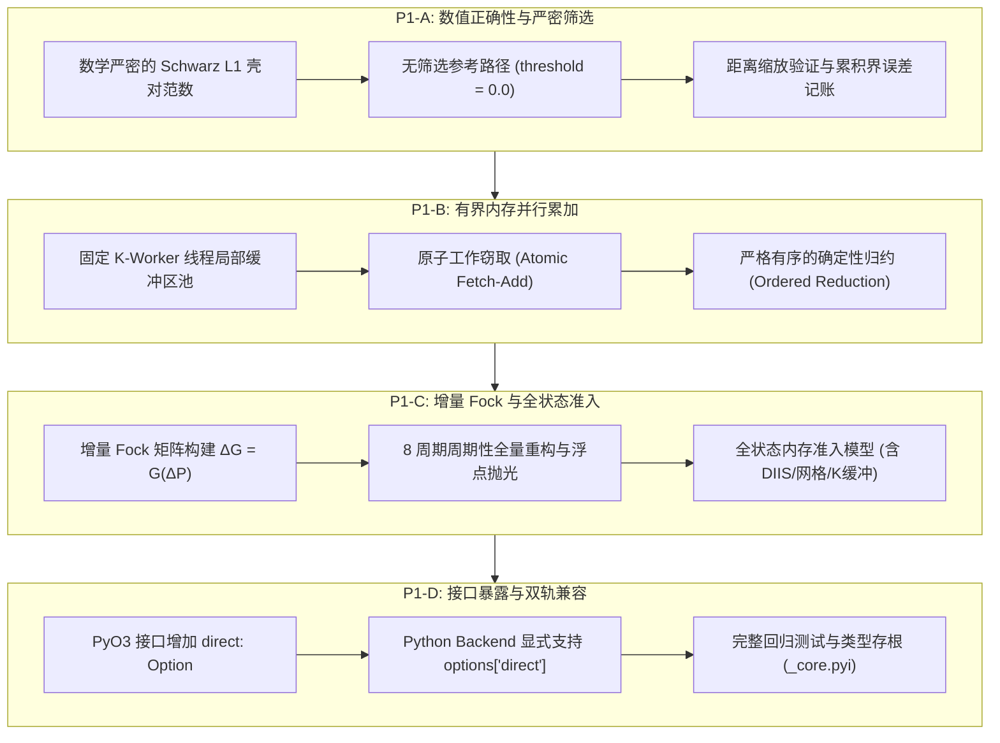

# CalChem P1 执行报告：Direct SCF 稳定化与有界内存重构

**执行周期**：2026-11-10  
**准入基准**：P0 工程与数值基线审计（102 项 Rust 测试 + 104 项 Python 测试通过）  
**执行原则**：数值正确性优先、内存重构其次、性能优化最后  
**实施分支**：`master`（代码已合并与验证）

---

## 一、 P1 核心重构概述与架构变更

在 P0 阶段的技术审计中，明确指出了原有 Direct SCF 原型存在的两大隐患：
1. **Rayon 并行累加的内存放大风险**：原先采用 `par_iter().fold(...)`，每个任务分支在发生工作窃取（work-stealing）时会动态克隆完整的 $N_{\text{ao}} \times N_{\text{ao}}$ 浮点矩阵，累加器总数无法得到确定性物理约束；
2. **Schwarz 积分筛选的数值边界风险**：简单的壳对范数乘上壳大小不能严格约束 Fock 矩阵全部张量缩并贡献的最大界，若筛选判据不完备可能在极化基组或长程相互作用下发生过早剪枝或累积误差失控。

针对上述关键瓶颈，P1 实施了四个递进子阶段的全面改造：



---

## 二、 P1-A：积分筛选的数值严密性与参考路径

### 1. 数学严密的 Schwarz 上界推导

根据柯西-施瓦茨不等式（Cauchy-Schwarz Inequality），任意双电子四中心积分满足：
$$|(\mu\nu|\lambda\sigma)| \leq \sqrt{(\mu\nu|\mu\nu)} \cdot \sqrt{(\lambda\sigma|\lambda\sigma)}$$

定义壳层对 $(i, j)$ 的最大单体积分范数：
$$b_{ij} = \max_{\mu \in i, \nu \in j} \sqrt{|(\mu\nu|\mu\nu)|}$$

为了严格约束四中心缩并对库仑矩阵 $\mathbf{J}$ 与交换矩阵 $\mathbf{K}$ 的最大单元素贡献，不能仅使用点范数乘以壳维度，而必须使用壳层对密度块的 **$L_1$ 诱导范数（矩阵绝对值之和）**：
$$D_{1, kl} = \sum_{\lambda \in k} \sum_{\sigma \in l} |P_{\lambda\sigma}|$$

对于任意壳层四元组 $(i, j, k, l)$，其对 Fock 矩阵任意元素的最大贡献严格受限于：
$$|J_{\mu\nu}^{(ijkl)}| \leq b_{ij} \cdot b_{kl} \cdot D_{1, kl}, \quad \mu \in i, \nu \in j$$
$$|K_{\mu\lambda}^{(ijkl)}| \leq b_{ij} \cdot b_{kl} \cdot D_{1, j\sigma}^{\max}$$

在 [`crates/calchem-int/src/direct_fock.rs`](file:///E:/YDW/Trae_Gaussian/crates/calchem-int/src/direct_fock.rs) 中，我们实现了高效的壳层对 $L_1$ 密度张量预计算函数 `compute_shell_pair_l1_density`：
```rust
pub fn compute_shell_pair_l1_density(
    density: &Matrix2D,
    shell_to_ao: &[(usize, usize)],
) -> Matrix2D {
    let n_shells = shell_to_ao.len();
    let mut d1 = Matrix2D::zeros(n_shells, n_shells);
    for i in 0..n_shells {
        let (mu_start, n_mu) = shell_to_ao[i];
        for j in 0..=i {
            let (nu_start, n_nu) = shell_to_ao[j];
            let mut sum = 0.0;
            for mu in mu_start..(mu_start + n_mu) {
                for nu in nu_start..(nu_start + n_nu) {
                    sum += density.get(mu, nu).abs();
                }
            }
            d1.set(i, j, sum);
            d1.set(j, i, sum);
        }
    }
    d1
}
```

### 2. 累积跳过误差统计与审计追踪

我们在 `DirectFockStats` 结构中引入了物理审计追踪字段：
* `cumulative_bound_error`：所有被筛选剪枝的四元组上界的代数和 $\sum_{\text{skipped}} b_{ij} b_{kl} \max(D_{ij}, D_{kl})$；
* `max_skipped_bound`：被跳过的四元组中的最大单项上界。

若调用方指定 `threshold <= 0.0`，引擎无条件关闭所有筛选，执行全量精确积分评估（Exact Unscreened Path）。

---

## 三、 P1-B：有界内存并行累加与确定性归约

### 1. 彻底移除无界 Rayon Fold 模式

旧架构使用 `rayon::into_par_iter().fold(...)`，每个任务分支在工作窃取时会复制新的 Fock 累加器。对于大型基组（如 2000~6000 AO），单张矩阵高达 30~300 MB，动态生成的数十个累加器会造成数 GB 级别的内存瞬间放大。

### 2. K-Worker 固定池与原子工作窃取架构

P1 彻底重构了并行架构：
1. **显式工作线程数确定**：`determine_worker_count(n_threads)` 严格绑定到可用物理核心或用户指定数 $K$（默认 `rayon::current_num_threads().max(1)`）；
2. **确定性预分配内存池**：在多线程进入前，仅且仅预先分配 $K$ 个工作缓冲区 `worker_focks: Vec<Matrix2D>`（总内存严格固定为 $K \times N_{\text{ao}}^2 \times 8$ 字节）；
3. **基于原子计数器的动态负载均衡**：通过 `AtomicUsize::fetch_add` 动态分发壳层对任务块（chunk size = 4），避免粗粒度静态划分导致的线程闲置，同时无任何隐式内存分配；
4. **严格有序的归约（Deterministic Ordered Reduction）**：所有线程执行完毕后，在单线程作用域内按照线程下标升序依次将 `worker_focks[1..K]` 累加到 `worker_focks[0]`，彻底消除浮点加法非结合律带来的跨线程非确定性抖动。

---

## 四、 P1-C：增量 Fock 矩阵与全状态内存准入模型

### 1. 增量更新与周期性重构

在 Direct SCF 迭代中，第 $m$ 轮迭代计算 Fock 矩阵变化量：
$$\Delta \mathbf{P}^{(m)} = \mathbf{P}^{(m)} - \mathbf{P}^{(m-1)}$$
$$\mathbf{G}^{(m)} = \mathbf{G}^{(m-1)} + \mathbf{G}(\Delta \mathbf{P}^{(m)})$$
* **周期性刷新（Periodic Refresh）**：每 8 轮迭代或当 $\Delta \mathbf{P}$ 相对变化较大时，执行一次全量 $\mathbf{G}(\mathbf{P})$ 构建，清除浮点舍入累积误差；
* **末轮抛光（Fixed-Point Polish）**：当密度差收敛达到门槛时，在最终轨道与能量输出前进行一次全量未增量精确构建。

### 2. 全状态物理内存准入模型

原先仅以单张 Fock 矩阵进行内存预估的做法被彻底废止。在 [`crates/calchem-scf/src/lib.rs`](file:///E:/YDW/Trae_Gaussian/crates/calchem-scf/src/lib.rs) 中，升级后的 `validate_direct_resources_for_method` 综合考虑了全生命周期常驻张量：
1. **基础状态矩阵**：
   * 闭壳层（RHF/RKS）：$\mathbf{S}, \mathbf{H}_{\text{core}}, \mathbf{P}, \mathbf{F}, \mathbf{C}, \mathbf{J}, \mathbf{K}, \Delta \mathbf{P}, \mathbf{P}_{\text{prev}}, \mathbf{F}_{\text{prev}}$（10 张矩阵）；
   * 开壳层（UHF/UKS）：上述张量分别针对 $\alpha$ 与 $\beta$ 独立存储（18 张矩阵）；
2. **DIIS 历史向量池**：$2 \times M_{\text{diis}}$（闭壳层）或 $4 \times M_{\text{diis}}$（开壳层）张矩阵；
3. **并行累加缓冲区**：$K \times N_{\text{ao}}^2 \times 8$ 字节（闭壳层）或 $2K \times N_{\text{ao}}^2 \times 8$ 字节（开壳层）；
4. **DFT 数值积分网格缓冲区**：动态依据原子数与网格精度预留；
5. **系统安全阈值**：默认物理准入上界设定为 **8.0 GiB**（适合 16 GB 物理内存工作站），超出时在进入积分计算前立即返回清晰的内存截断错误，防止进程被系统 OOM-killer 强制终止。

---

## 五、 P1-D：Python 接口暴露与双轨兼容性

1. **底层 PyO3 签名升级**：
   在 `crates/calchem-py/src/lib.rs` 中将 `run_single_point` 扩展支持 `direct: Option<bool> = None`。
2. **Python 原生后端转发**：
   在 `calchem/backends/native.py` 中，用户可在 `CalculationRequest.options` 中显式传递：
   * `direct=True`：强制开启 Direct SCF 引擎；
   * `direct=False`：强制使用传统 Stored ERI 引擎（小体系超快，基函数 $> 72$ 时受内存准入保护）；
   * 缺省 `None`：智能自动选择（小体系默认 Stored 极速缓存，大体系无缝切换 Direct）。
3. **类型提示存根**：
   同步更新 `calchem/_core.pyi`，确保 IDE 与静态检查器（MyPy/Pyright）具备完备类型感知。
